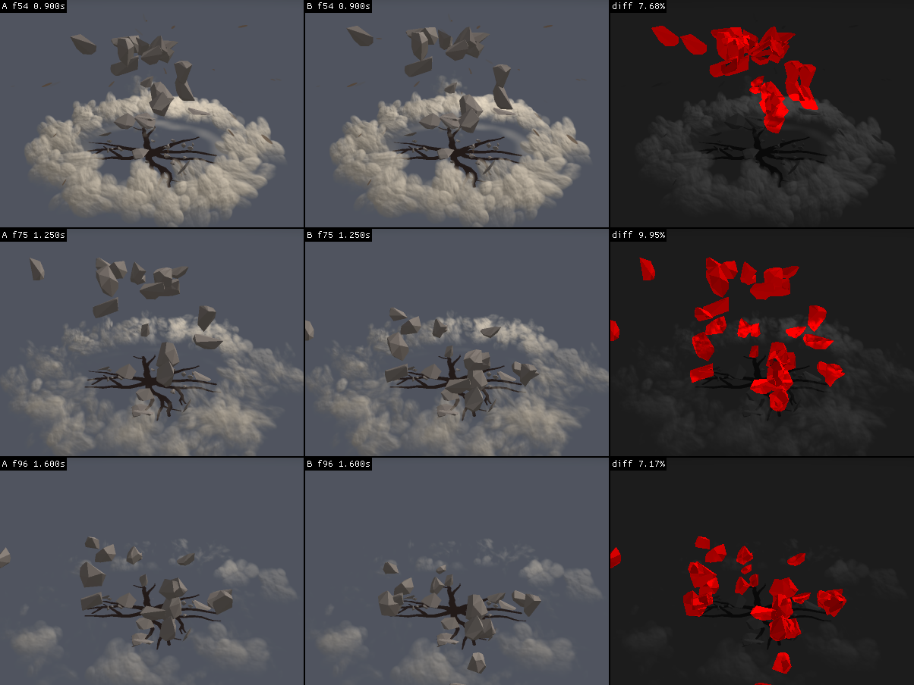
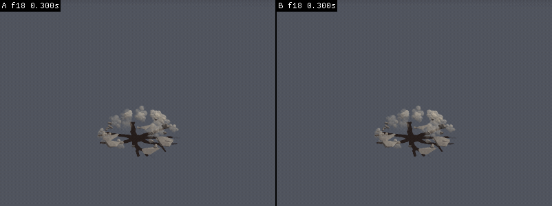

# MonoGame.AgentTools

Close the loop on agentic game dev. Your coding agent builds, plays, captures and profiles your MonoGame
game, then iterates autonomously.


*Captured with the `capture` tool and turned into a GIF with the `gif` tool. The effect is from a
MonoGame visual-effects study.*

Agents can read and write game code, but they can't see the game. MonoGame.AgentTools gives them eyes
and a stopwatch, through an MCP server and a small NuGet package:

- **Deterministic capture.** The game's real `Update` and `Draw` run at a fixed time step with a hidden
  window, so the same build and arguments produce the same frames every time.
- **Contact sheets.** Frames side by side in one labeled image, the way animation and VFX reviews judge
  timing and spacing. Agents read motion from these.
- **Before and after.** The same frames from two captures, with every changed pixel marked.
- **GIFs for people.** Agents can't watch an animation; you can. Any capture becomes a GIF that plays on
  a double-click.
- **Measurements that say what they mean.** Frame times, warm-up, allocations, GC, memory growth, JIT,
  draw calls and hitches, each with a verdict, plus numbers from your own game.
- **Free when off.** Debug builds only by default. In other builds the calls are compiled out and the
  assembly is left out of the output. The tools allocate nothing per frame.

## Quick start

1. Reference the package from your game's executable project:

   ```xml
   <PackageReference Include="MonoGame.AgentTools" Version="0.1.0" />
   ```

2. Attach it in `Main`, before `Run`:

   ```csharp
   using var game = new MyGame();
   AgentTools.Attach(game, args);
   game.Run();
   ```

3. Build in Debug. The build adds the MCP server to `.mcp.json` at the root of your repository:

   ```json
   { "mcpServers": { "monogame-agenttools": { "type": "stdio", "command": "dotnet", "args": ["dnx", "MonoGame.AgentTools.Mcp@0.1.0", "--yes", "mcp"] } } }
   ```

   Commit it, and every agent that reads `.mcp.json` (Claude Code, for example) can use the tools. See
   [MCP server](docs/mcp.md) for VS Code, Cursor and other clients.

Then ask your agent something like *"The earth slam feels floaty. Make the rocks land harder, then show
me a before and after GIF."* The rest of this page is what it works with.

Your `Update` and `Draw` overrides should call `base.Update(gameTime)` and `base.Draw(gameTime)`, as the
MonoGame templates do.

## What your agent sees

### A capture

The agent calls `capture`. The tool builds the game, runs it and returns a short reading of the run and
a labeled contact sheet. `gameArgs` go to the game itself, here to pick the effect and camera:

```json
{ "frames": 150, "gameArgs": ["--show", "earthslam", "--camera", "front", "--studio"], "name": "slam-heavy" }
```

```text
Captured Study2.Game.DesktopGL to .agenttools/captures/slam-heavy
Sheet .agenttools/captures/slam-heavy/sheets/f1-f150_c4_n12.png (1286x544), 4 per row: f1 0.017s, f15 0.250s, f28 0.467s, f42 0.700s, f55 0.917s, f69 1.150s, f82 1.367s, f96 1.600s, f109 1.817s, f123 2.050s, f136 2.267s, f150 2.500s
150 frames, fixed 16.6667 ms step (60 fps): 2.5 s game time, 1.59 s wall, 1280x720
Notes: Esc - exit; show earthslam, camera front, studio
Warm-up: memory stable at f129; performance not reached (still active: JitCompilation); run longer to reach it
Frame CPU ms (all frames, includes first-use costs): p50 0.48, p95 0.78, p99 1.2, max 1.75
Allocations after memory stable: game thread 0 B, other threads 0 B
Growth after memory stable: too short to judge: 0.1 s after the memory gate, needs 5 s; heap 0, private 0, GPU resources 0 (heap counts uncollected garbage)
GC: none · JIT on game thread: 9 methods, 1 ms
Render per frame (mean/max): draws 34/72, primitives 791/1122, target switches 13/26
Hitches (> 2.48 ms): none
Custom metrics (first → last, min to max):
  particles: 14 → 36, 14 to 192
```


The agent reads the sheet as an image, so it can judge what's on screen and how it moves, then zoom in
with `contact_sheet` (a shorter time range, a crop) without running the game again.

### Before and after

Capture a baseline with a `name`, make a change, and capture again with `sheet: { against: "<name>" }`.
Each row shows the same frame from both captures and every pixel that changed, in red. Captures are
deterministic, so any red is a real difference. Here A is a floaty version of the slam, with half the
gravity and a slower launch to the same height, and B is the fix. Only the rocks changed: by 1.25 s,
B's have landed while A's still hang in the air.



### A GIF for you

When a choice is about how something feels in motion, the agent can make a GIF and give you its path.
`against` plays the two versions side by side:



### Performance

For numbers that describe the game rather than the capture, the agent captures without saving frames, in
real time, for at least 5 seconds:

```json
{ "seconds": 8, "save": "none", "realtime": true }
```

```text
480 frames, fixed 16.6667 ms step (60 fps): 8 s game time, 8.48 s wall, 1280x720
Notes: Esc - exit; show earthslam, camera front, studio
Warm-up: memory stable at f62; performance stable at f129, then disturbed 3 times from f180
Frame CPU ms (after warm-up): p50 0.29, p95 0.73, p99 1.02, max 1.27
Allocations after memory stable: game thread 0 B, other threads 0 B
Growth after memory stable, 7 s: steady: no GPU resources leaked (private bytes are judged from 30 s); heap 0, private -2.3 MB, GPU resources 0 (heap counts uncollected garbage)
GC: none · JIT on game thread: 10 methods, 1.35 ms
Render per frame (mean/max): draws 31/42, primitives 695/1128, target switches 13/13
Hitches (> 2.32 ms): none
Custom metrics (first → last, min to max):
  particles: 14 → 46, 6 to 192
```

Numbers taken while code is still compiling or memory is still growing describe startup, not the game,
so two warm-up gates decide when measurements count. Any game-thread allocation after the memory gate is
a per-frame allocation worth fixing. See [Performance](docs/performance.md) for how to read each line.

## While you play

```
MyGame --agenttools-hud
```

The HUD shows the same measurements in the corner while you play: frame times, allocations, GCs, memory,
GPU resources, JIT, the warm-up gates, draw calls and your custom metrics. Backtick toggles it.
`--agenttools-stats out/live.json` records a whole session and writes it when the game exits. See
[Live play](docs/live.md).

<!-- TODO: docs/images/hud.png, a screenshot of a game with the HUD on. -->

## Telling the agent about your game

```csharp
AgentTools.Attach(game, args, new()
{
    Notes = "Controls:\nEsc - Exit",
    CustomMetrics = [("particles", () => game.ParticleCount), ("enemies", () => game.Enemies.Count)],
});
```

Notes appear on the HUD and in every capture's summary. Custom metrics are recorded every frame and
summarized (first, last, min, max), so an agent can check that the particle count really settles or that
the enemies really spawned. Return `double.NaN` for a frame with no value. They run on the game thread
every frame, so they must not allocate.

Your game's own command-line flags pass through `gameArgs`, so a scene or camera setup is a capture
argument rather than a code change.

## Documentation

- [MCP server](docs/mcp.md): setup for each client, and every tool with examples
- [Capture](docs/capture.md): command-line options, determinism and output files
- [Performance](docs/performance.md): warm-up gates, allocations, memory growth and hitches
- [Live play](docs/live.md): the HUD and session stats
- [Design](docs/design.md): how it works and why, with the precedents it follows

Agents get the same guidance from the server's `guide` tool.

## Requirements

- **Your game:** MonoGame 3.8.5 DesktopGL, targeting .NET 8 or later.
- **Your machine:** the .NET 10 SDK or later, which runs the MCP server through `dotnet dnx`. It installs
  beside older SDKs and doesn't change what your game targets.
- Tested on Windows. CI builds and runs the unit tests on Linux and macOS too, but captures haven't been
  run there yet.
- Pixels can differ slightly across GPUs and drivers, so comparisons across machines need a tolerance.

## Enabling in other configurations

Everything follows one property, true by default in Debug:

```xml
<AgentToolsEnabled>true</AgentToolsEnabled>
```

Set it to `true` to use the tools in Release (the MCP `capture` tool takes `configuration: "Release"`), or
`false` to turn them off in Debug too.

## Building from source

The repository builds with the .NET SDK pinned in [`global.json`](global.json) (11.0.100) and runs its
tests on .NET 11:

```
dotnet build
dotnet test
dotnet format --verify-no-changes
```

CI runs the same three on Windows, Linux and macOS, in Debug and Release, and they must pass before a
pull request can merge.

## License

MIT. See [LICENSE](LICENSE) and [third-party notices](THIRD-PARTY-NOTICES.md).
