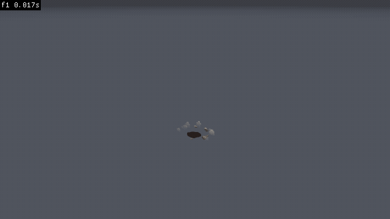
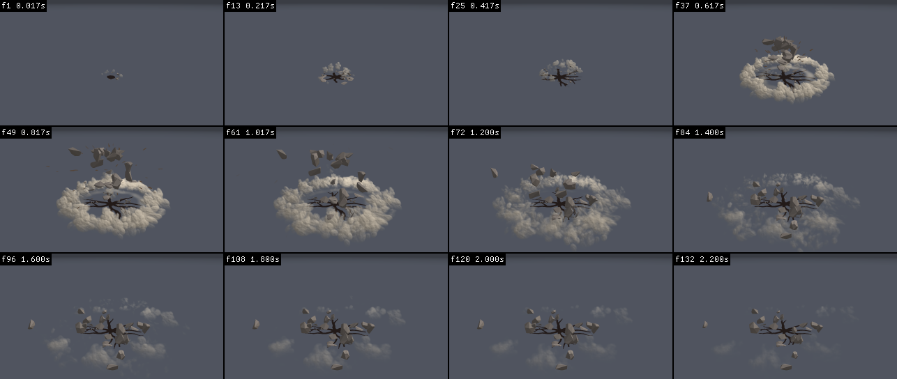

# MonoGame.AgentTools

Close the loop on agentic game dev. Your coding agent builds, plays, captures and profiles your MonoGame
game, then iterates autonomously.



*The Earth Slam, an effect from a MonoGame visual-effects study. Made with `capture`, then `gif` of
its first 1.9 s at 30 fps.*

Agents can read and write game code, but they can't see the game. MonoGame.AgentTools gives them eyes,
hands and a stopwatch, through an MCP server and a small NuGet package, and gives you a view of what they
measure.

**For the agent:**

- **Capture.** The game's real `Update` and `Draw` run at a fixed time step with a hidden window, so the
  same build, arguments and input produce the same frames every time.
- **Contact sheets.** Frames side by side in one labeled image, the way animation and VFX reviews judge
  timing and spacing. Two captures compare frame by frame, with every changed pixel marked.
- **Playing the game.** Keyboard, mouse and gamepad input from a script, or a human's recording replayed
  exactly.
- **Performance.** Frame times, warm-up, allocations, GC, memory growth, JIT, draw calls and hitches,
  each with a verdict, plus numbers from your own game.

**For the human:**

- **HUD.** The same measurements in the corner while you play.
- **GIFs.** Agents can't watch an animation; you can. Any capture becomes a GIF, and two captures play
  side by side.
- **Recording.** Play the game, and the agent replays exactly what you pressed.

Debug builds only by default. In other builds the calls are compiled out and the assembly is left out
of the output. The tools allocate nothing per frame.

## Quick Start

1. Reference the package from your game's executable project:

   ```xml
   <PackageReference Include="MonoGame.AgentTools" Version="0.1.0" />
   ```

2. Attach it in `Main`, before `Run`:

   ```csharp
   using var game = new MyGame();
   AgentTools.Attach(game, args, new() { ShowHud = true });
   game.Run();
   ```

   `ShowHud` shows the HUD whenever you run the game. Leave it out to start with the HUD hidden; backtick
   toggles it either way.

3. Build in Debug. The build adds the MCP server to `.mcp.json` at the root of your repository:

   ```json
   { "mcpServers": { "monogame-agenttools": { "type": "stdio", "command": "dotnet", "args": ["dnx", "MonoGame.AgentTools.Mcp@0.1.0", "--yes", "mcp"] } } }
   ```

   Commit it, and every agent that reads `.mcp.json` (Claude Code, for example) can use the tools. See
   [MCP server](docs/mcp.md) for VS Code, Cursor and other clients.

Then ask your agent something like *"The earth slam feels floaty. Make the rocks land harder, then show
me a before and after GIF."* The rest of this page is what it works with.

Your `Update` and `Draw` overrides should call `base.Update(gameTime)` and `base.Draw(gameTime)`, as the
MonoGame templates do.

## For the Agent

### Capture

The agent calls `capture`. The tool builds the game, runs it and returns a short reading of the run and
a labeled contact sheet. `gameArgs` go to the game itself, here to pick the effect and camera:

```json
{ "frames": 150, "gameArgs": ["--show", "earthslam", "--camera", "front", "--studio"], "name": "slam-heavy" }
```

```text
Captured Study2.Game.DesktopGL to .agenttools/captures/slam-heavy
Sheet .agenttools/captures/slam-heavy/sheets/f1-f150_c4_n12.png (1286x544), 4 per row: f1 0.017s, f15 0.250s, f28 0.467s, f42 0.700s, f55 0.917s, f69 1.150s, f82 1.367s, f96 1.600s, f109 1.817s, f123 2.050s, f136 2.267s, f150 2.500s
150 frames, fixed 16.6667 ms step (60 fps): 2.5 s game time, 1.59 s wall, 1280x720
Notes: Esc - exit; show earthslam, camera front, studio
Warm-up: memory stable at f129; performance not reached (still active: JitCompilation); run longer to reach it
Frame CPU ms (all frames, includes first-use costs): p50 0.48, p95 0.78, p99 1.2, max 1.75
Allocations after memory stable: game thread 0 B, other threads 0 B
Growth after memory stable: too short to judge: 0.1 s after the memory gate, needs 5 s; heap 0, private 0, GPU resources 0 (heap counts uncollected garbage)
GC: none · JIT on game thread: 9 methods, 1 ms
Render per frame (mean/max): draws 34/72, primitives 791/1122, target switches 13/26
Hitches (> 2.48 ms): none
Custom metrics (first → last, min to max):
  particles: 14 → 36, 14 to 192
```

### Contact Sheets

The capture returns a contact sheet, which the agent reads as an image, so it can judge what's on
screen and how it moves:



*The sheet that `capture` call returned: 12 frames picked evenly across the 2.5 s run, each labeled with
its frame and game time. The ground cracks in two jolts, then erupts: a dust ring rolls out, and rocks
are thrown up and land.*

`contact_sheet` zooms in (a shorter time range, a crop) without running the game again. With `against`,
it compares two captures: each row shows the same frame from both and every pixel that changed, in red.
Captures are deterministic, so any red is a real difference. Here A is a floaty version of the slam,
with half the gravity and a slower launch to the same height, and B is the fix. Only the rocks changed:
by 1.25 s, B's have landed while A's still hang in the air. You see the same comparison as a
[side-by-side GIF](#gifs).


*`contact_sheet` with `{ "capture": "slam-heavy", "against": "slam-floaty", "from": 0.9, "to": 1.6,
"count": 3, "crop": "240,40,800,600" }`, after one `capture` of each version. Each row is A, B, then
their changed pixels.*

### Playing the Game

A capture can press keys, click the mouse and push gamepad sticks, from a script the agent writes:

```json
{ "input": "f60 Space down\nf75 Space up\nt1.5 MouseLeft down 640,360", "name": "jump" }
```

Each line is when (`f60` is frame 60, `t1.5` is 1.5 s of game time), a control in MonoGame's own names,
and what it does. `input` also takes a file, or a capture's name to replay its input after a fix:

```json
{ "input": "jump", "name": "jump-after-fix", "sheet": { "against": "jump" } }
```

It replays [your recordings](#recording) the same way, frame for frame. Your game keeps calling
`Keyboard`, `Mouse` and `GamePad.GetState()` and doesn't change. Captures never read your own cursor or
gamepad, so they stay repeatable. See [Input and replay](docs/input.md).

### Performance

For numbers that describe the game rather than the capture, the agent captures without saving frames, in
real time, for at least 5 seconds:

```json
{ "seconds": 8, "save": "none", "realtime": true }
```

```text
480 frames, fixed 16.6667 ms step (60 fps): 8 s game time, 8.48 s wall, 1280x720
Notes: Esc - exit; show earthslam, camera front, studio
Warm-up: memory stable at f62; performance stable at f129, then disturbed 3 times from f180
Frame CPU ms (after warm-up): p50 0.29, p95 0.73, p99 1.02, max 1.27
Allocations after memory stable: game thread 0 B, other threads 0 B
Growth after memory stable, 7 s: steady: no GPU resources leaked (private bytes are judged from 30 s); heap 0, private -2.3 MB, GPU resources 0 (heap counts uncollected garbage)
GC: none · JIT on game thread: 10 methods, 1.35 ms
Render per frame (mean/max): draws 31/42, primitives 695/1128, target switches 13/13
Hitches (> 2.32 ms): none
Custom metrics (first → last, min to max):
  particles: 14 → 46, 6 to 192
```

Numbers taken while code is still compiling or memory is still growing describe startup, not the game,
so two warm-up gates decide when measurements count. Any game-thread allocation after the memory gate is
a per-frame allocation worth fixing. See [Performance](docs/performance.md) for how to read each line.

## For the Human

### HUD

With `ShowHud`, the HUD shows the agent's measurements in the corner while you play: frame times,
allocations, GCs, memory, GPU resources, JIT, the warm-up gates, draw calls and your custom metrics.
Backtick toggles it. A whole session can also be recorded as stats; see [Live play](docs/live.md).

<!-- TODO: docs/images/hud.png, a screenshot of a game with the HUD on. -->

### GIFs

When a choice is about how something feels in motion, the agent can make a GIF and give you its path.
`against` plays two versions side by side, the same comparison the agent read as a
[contact sheet](#contact-sheets):


*`gif` with `{ "capture": "slam-heavy", "against": "slam-floaty", "from": 0.3, "to": 2.3, "crop":
"240,40,800,600", "width": 400 }`: the floaty slam on the left, the heavy one on the right, at 30 fps.*

### Recording

When something goes wrong while you play, record it and hand it to the agent:

```
MyGame --agenttools-record sessions/boss
```

`sessions/boss.input` is written as you go, so even a crash keeps it. Give the agent its path, and it
[replays exactly what your game read](#playing-the-game), frame for frame, as many times as it needs.

## Configuration

### Notes and Metrics

```csharp
AgentTools.Attach(game, args, new()
{
    ShowHud = true,
    Notes = "Controls:\nEsc - Exit",
    CustomMetrics = [("particles", () => game.ParticleCount), ("enemies", () => game.Enemies.Count)],
});
```

Notes appear on the HUD and in every capture's summary. Custom metrics are recorded every frame and
summarized (first, last, min, max), so an agent can check that the particle count really settles or that
the enemies really spawned. Return `double.NaN` for a frame with no value. They run on the game thread
every frame, so they must not allocate.

Your game's own command-line flags pass through `gameArgs`, so a scene or camera setup is a capture
argument rather than a code change.

### Build Configurations

Everything follows one property, true by default in Debug:

```xml
<AgentToolsEnabled>true</AgentToolsEnabled>
```

Set it to `true` to use the tools in Release (the MCP `capture` tool takes `configuration: "Release"`), or
`false` to turn them off in Debug too.

## Requirements

- **Your game:** MonoGame 3.8.5 DesktopGL, targeting .NET 8 or later.
- **Your machine:** the .NET 10 SDK or later, which runs the MCP server through `dotnet dnx`. It installs
  beside older SDKs and doesn't change what your game targets.
- Tested on Windows. CI builds and runs the unit tests on Linux and macOS too, but captures haven't been
  run there yet.
- Pixels can differ slightly across GPUs and drivers, so comparisons across machines need a tolerance.

## Documentation

- [MCP server](docs/mcp.md): setup for each client, and every tool with examples
- [Capture](docs/capture.md): command-line options, determinism and output files
- [Performance](docs/performance.md): warm-up gates, allocations, memory growth and hitches
- [Input and replay](docs/input.md): input scripts, recording, and frame timing
- [Live play](docs/live.md): the HUD, session stats and recording
- [Design](docs/design.md): how it works and why, with the precedents it follows

Agents get the same guidance from the server's `guide` tool.

## Building from Source

The repository builds with the .NET SDK pinned in [`global.json`](global.json) (11.0.100). Each
component's tests run on the lowest runtime it supports and the newest: the library's on .NET 8 and 11,
the MCP server's on .NET 10 and 11. `dotnet test` needs the .NET 8 and 10 runtimes installed beside the
SDK.

```
dotnet build
dotnet test
dotnet format --verify-no-changes
```

CI runs the same three on Windows, Linux and macOS, in Debug and Release, and they must pass before a
pull request can merge. What they can't cover yet, such as tests that need a GPU, is checked by hand
before each release: see [Manual tests](docs/manual-tests.md).

## License

MIT. See [LICENSE](LICENSE) and [third-party notices](THIRD-PARTY-NOTICES.md).
