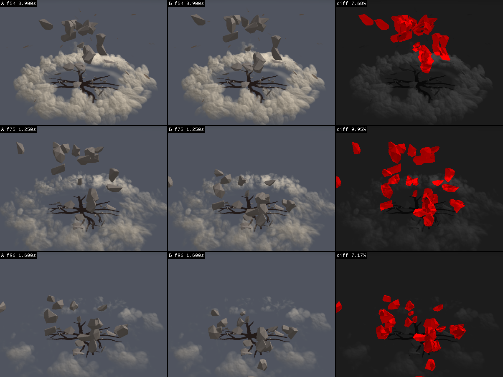
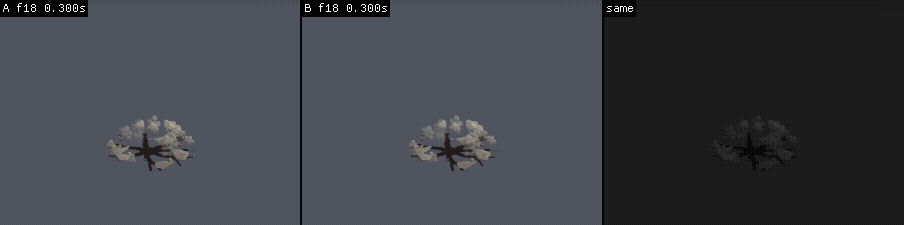

# MCP server

`MonoGame.AgentTools.Mcp` lets an agent build and capture your game and look at the results, as tool
calls. It runs over stdio from the NuGet package through `dotnet dnx`, so there's nothing to install
beyond the .NET 10 SDK.

## Setup

### Automatic

Building a game that references `MonoGame.AgentTools` (with the tools enabled, so Debug by default) adds
the server to `.mcp.json` at the root of your repository, the folder with `.git`:

```json
{
  "mcpServers": {
    "monogame-agenttools": {
      "type": "stdio",
      "command": "dotnet",
      "args": ["dnx", "MonoGame.AgentTools.Mcp@0.1.0", "--yes", "mcp"]
    }
  }
}
```

- It also writes `.vscode/mcp.json` and `.cursor/mcp.json` when those folders exist.
- It merges into what's there: other servers, comments and formatting are kept.
- It updates the version when the package version changes. An entry you've edited is left alone.
- The entry is the same for everyone (no machine paths), so commit it.
- It's skipped in CI builds and when the tools are disabled.

| Property | |
|---|---|
| `<AgentToolsInstallMcp>false</AgentToolsInstallMcp>` | Don't touch any MCP configuration |
| `<AgentToolsRoot>path</AgentToolsRoot>` | Use this folder instead of the repository root |

### Other clients

Any MCP client can run the same command. For a client that takes a JSON configuration:

```json
{ "command": "dotnet", "args": ["dnx", "MonoGame.AgentTools.Mcp@0.1.0", "--yes", "mcp"] }
```

The server works on the game projects under its current directory, so start it from your repository
root. `--yes` skips `dnx`'s first-run download prompt, which would otherwise hang a server that talks
over stdio. The command is `dotnet dnx` rather than `dnx` because on Windows `dnx` is a `.cmd` script,
which clients that start servers without a shell can't run.

## Tools

| Tool | What it does |
|---|---|
| [`list_games`](#list_games) | Game projects in the workspace that reference the package |
| [`capture`](#capture) | Builds the game, captures it, returns a reading of the run and a contact sheet |
| [`profile`](#profile) | Builds the game and runs it paced in real time for performance numbers |
| [`contact_sheet`](#contact_sheet) | Another sheet from an existing capture: a closer time range, a crop, or a comparison |
| [`gif`](#gif) | An animated GIF of a capture for a person to watch |
| [`guide`](#guide) | Setup, options and how to read the measurements, in depth |

Captures and profiles are written to `.agenttools/captures/<name>` in the workspace, a folder that
ignores itself in git. Unnamed ones are pruned to the 10 most recent of each; named ones are kept, for comparing
before and after a change. Live play records sessions beside them, in `.agenttools/sessions`
([Live play](live.md#sessions)).

### list_games

Lists the executable projects under the workspace that reference `MonoGame.AgentTools`. `capture` and
`profile` need a `project` only when there's more than one.

```text
MyGame\MyGame.csproj
Tools\LevelViewer\LevelViewer.csproj
```

### capture

Builds the game and runs its real `Update` and `Draw` at a fixed step with a hidden window, then exits.
Each option that reaches the game is its [command-line flag](capture.md#options) in camelCase, and a
rejected option comes back naming the parameter.

| Option | Default | |
|---|---|---|
| `project` | the only game | A `.csproj` or its folder, when the workspace has several games |
| `duration` | `1s` | `"3s"` (game seconds) or `"150f"` (frames); with input, to 1 s after its last event |
| `fps` | the game's step | Fixed steps per second, overriding the game's `TargetElapsedTime` |
| `input` | | Input to play: the script itself, an `.input` file, or a capture's or session's name ([Input and replay](input.md)) |
| `timing` | `fixed` | `fixed`, `real`, a `.timing` file, or a capture's or session's name to replay its frame times |
| `size` | `1280x720` | Backbuffer size, the same on every machine; `native` for the game's own |
| `save` | `all` | Frames to write as PNG: `all`, `none`, `every:N` or a list such as `1,30,60` |
| `jitNames` | off | Name the methods JIT-compiled during each hitch; allocates on another thread and slows those frames |
| `hud` | off | Draw the HUD into the frames, as you see it in play. Its numbers are wall-clock measurements, so its area differs between runs; comparisons leave it out |
| `gameArgs` | | Your game's own command-line flags, such as a scene or camera |
| `sheet` | 12 frames | The contact sheet: `from`, `to`, `count`, `columns`, `crop`, `baseline`, `diff` |
| `name` | `<game>-<time>` | Output folder; a named capture is kept |
| `detail` | `brief` | `brief`: one line per check. `full`: `summary.json` itself |
| `configuration` | `Debug` | Build configuration; others need `AgentToolsEnabled` |
| `framework` | the first listed | For a game with several `TargetFrameworks`, which one to build and run |
| `timeoutSeconds` | 300 | Kill the game after this long |

The brief result is one plain-text line per check, about 1 KB, with each verdict stated. There's an
example in the [README](../README.md#capture). Model clients keep images up to 1568 px on the long edge,
so sheets stay within that.

Examples:

```json
{ "duration": "2s" }
{ "duration": "2s", "sheet": { "from": 0.4, "to": 0.9, "count": 12, "crop": "400,150,480,360" } }
{ "duration": "2s", "gameArgs": ["--level", "3"], "name": "before" }
{ "duration": "2s", "name": "after", "sheet": { "baseline": "before" } }
{ "input": "f30 Space down\nf45 Space up", "name": "jump" }
{ "input": "jump", "name": "jump-fixed", "sheet": { "baseline": "jump" } }
{ "input": "MyGame-20261121-093000", "name": "boss" }
{ "timing": "real", "duration": "10s", "name": "jitter" }
{ "duration": "2s", "hud": true, "save": "60" }
```

### profile

Runs the game paced to its step in real time, as your frames are when you play, with a hidden window and
no frames saved: the run for performance numbers ([Performance](performance.md)). It takes the same
options as `capture` except `save` and `sheet`, and runs `8s` by default; under 5 s the warm-up gates may
not open, and the notes say so. It returns the brief and the game's own 12-frame `sheet.png`, to confirm
what ran.

```json
{ }
{ "duration": "30s", "gameArgs": ["--level", "3"] }
{ "input": "MyGame-20261121-093000", "name": "boss-perf" }
```

### contact_sheet

Makes another sheet from a capture's saved frames without running the game again: zoom into a moment or
an effect after looking at the first sheet. Tiles are labeled with frame number and game time; small crops
are enlarged by a whole factor so pixels stay crisp.

| Option | Default | |
|---|---|---|
| `capture` | | The capture's name, or a folder |
| `from`, `to` | the whole capture | Time range in game seconds |
| `count` | 12 (6 when comparing) | Frames, picked evenly with both ends included; at most 48 (12 when comparing) |
| `columns` | 4 | Frames per row |
| `crop` | | `x,y,width,height` in frame pixels |
| `baseline` | | A capture to compare with |
| `diff` | on | With `baseline`, show the changed pixels beside A and B; off shows just A and B, larger |

With `baseline`, each row is one moment: the baseline (A), this capture (B), and the pixels that changed,
in red, brighter for larger changes, with the percentage changed. Any changed pixel counts, since the
same build and arguments draw the same frames. A HUD drawn with `hud` in either capture is left out and
shows in blue, since its numbers differ from run to run.



*A floaty Earth Slam (A) against the shipped one (B), from `{ "capture": "slam-heavy", "baseline":
"slam-floaty", "from": 0.9, "to": 1.6, "count": 3, "crop": "240,40,800,600" }`. Only the rocks changed.*

### gif

Makes an animated GIF from a capture's saved frames and returns its path. The agent can't watch it, so
the tool is for showing you motion, such as an A/B choice. The GIF plays on a double-click in Windows, in
browsers and in chat apps.

| Option | Default | |
|---|---|---|
| `capture` | | The capture's name, or a folder |
| `from`, `to` | the whole capture | Time range in game seconds |
| `fps` | 30 | Frames of game time per second, at most 50 (browsers slow down shorter GIF delays) |
| `speed` | 1 | Playback speed; 0.25 is quarter-speed slow motion |
| `width` | 640 | Width of each frame |
| `crop` | | `x,y,width,height` in frame pixels |
| `baseline` | | A capture to play beside this one, A on the left |
| `diff` | off | With `baseline`, a third panel of the changed pixels, as `contact_sheet` shows them |

Playback keeps game time: at 30 fps the frame delays run 3, 4, 3 hundredths of a second. A GIF has 256
colors, so smooth gradients are dithered and look slightly grainy; judge fine color from the PNG frames.
GIFs are saved in the capture's `gifs/` folder.

```json
{ "capture": "after", "from": 0.2, "to": 1.5, "speed": 0.5 }
{ "capture": "after", "baseline": "before", "crop": "370,110,540,500", "width": 300 }
{ "capture": "after", "baseline": "before", "diff": true, "width": 300 }
```

`diff` is off by default because people judge motion best from A and B alone; turn it on when the change
is too small to spot, or to show where it is:



*`{ "capture": "slam-heavy", "baseline": "slam-floaty", "diff": true, "from": 0.3, "to": 2.3, "crop":
"240,40,800,600", "width": 300 }`: only the rocks differ.*

### guide

Explains MonoGame.AgentTools in depth for the agent, by topic: `setup`, `capture`, `contact-sheets` and
`performance`. Called without a topic, it lists them. The server's always-loaded instructions stay a few
lines long; the guide holds the rest, so agents read it only when they need it.
