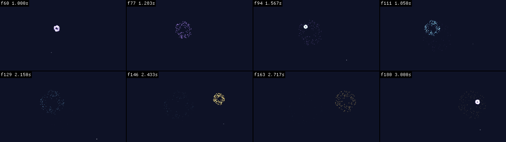

# Fireworks

A small MonoGame game set up for MonoGame.AgentTools: rockets rise and burst into sparks.



It shows what a game needs to do:

- [`Program.cs`](Program.cs) calls `AgentTools.Attach` before `Run`, with notes and a custom metric (the
  particle count).
- [`FireworksGame.cs`](FireworksGame.cs) seeds its random numbers, so every capture is the same, and keeps
  its particles in a fixed pool so nothing is allocated per frame. It also draws its largest frame once
  during loading, so `SpriteBatch` sizes its buffers before the game starts.

It draws with `SpriteBatch` and one white pixel, so it needs no content pipeline.

Run it:

```
dotnet run --project samples/Fireworks
dotnet run --project samples/Fireworks -- --agenttools-hud
dotnet run --project samples/Fireworks -- --agenttools-capture out/fireworks --agenttools-duration 4
```

From the repository root, an agent with the MCP server can capture it with `capture`.

The sample references the library as a project, since it lives in the same repository. In your game,
reference the package instead:

```xml
<PackageReference Include="MonoGame.AgentTools" Version="0.1.0" />
```
