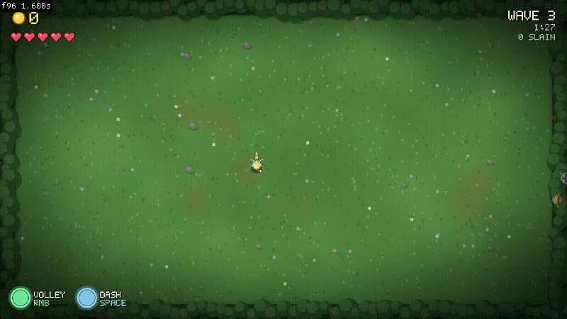

# One-shot: Goblin Gold

A complete game from one prompt, made by a coding agent with MonoGame.AgentTools installed. The game
is in [GoblinGold](GoblinGold), exactly as the agent wrote it; its [README](GoblinGold/README.md) is
the agent's own, with the controls and the choices it made.

<p align="center">
  <em>One-shotted by Claude Opus 5.5 Medium, 18 minutes, $3.76 (API cost).</em><br>
  
</p>

## The prompt

> Make a complete, polished top-down action game in this MonoGame project. You play as an elf archer
> shooting a bow at goblins, and each goblin bursts into treasure when it dies. The goblins keep coming
> and the game gets harder and harder until you die; your treasure is then your final score, shown on a
> game-over screen from which you can play again. Moving, aiming and shooting should feel tight and
> responsive, and hits, bursts and treasure should feel satisfying, with clear visual feedback. Use
> keyboard and mouse controls. No audio. Use no external asset files; draw everything in code. Work
> through to a finished game without stopping to ask me questions; where something is unspecified,
> decide and note the choice in a short README. Before you finish, make sure it builds, runs and plays
> well.

The prompt doesn't mention AgentTools. The agent found the tools through the MCP server's own
instructions, as any agent would in a project set up with the [Quick Start](../../README.md#quick-start).

## How it was run

1. `dotnet new mgdesktopgl`, with the target framework changed to `net11.0`.
2. The Quick Start's three steps: the package reference, `AgentTools.Attach` in `Program.cs`, and one
   build, which wrote `.mcp.json`.
3. A new Claude Code session in VS Code on that folder, in auto permission mode, given the prompt above.
   The agent worked to the end without a question or another message.

| | |
|---|---|
| Model | Claude Opus 5.5, medium effort |
| Claude Code | 2.1.330 |
| .NET SDK / MonoGame | 11.0.100 / 3.8.6.1 |
| MonoGame.AgentTools | 0.2.0 |
| Time | 18 minutes |
| Tokens | 4.48 M: 89 K output, 4.24 M cache read, 142 K cache write, 72 uncached input |
| Cost | $3.76 at API list price |
| Tool calls | 40, none failed |

## How it used the tools

19 of its 40 tool calls were AgentTools: 9 captures, 7 contact sheets, a profile, a GIF and one guide
topic. To test the game it gave it an autopilot and test-only options (`--bot`, `--seed`, `--time` to
start later in the difficulty curve), then:

- captured the title screen and short autopilot runs, and two full games on autopilot, which lasted 1:46
  and 2:09;
- played it with scripted keyboard and mouse input, and replayed that recording;
- zoomed in on hits and treasure bursts with cropped contact sheets, 8 frames over 0.4 s;
- profiled the late game: about 1 ms of CPU per frame, 3 ms at the 95th percentile, with over 100 goblins;
- fixed what it saw: spawn warnings left on screen after death, background flowers that looked like
  coins, and kill marks on the grass that looked like holes.

## Run it

With the .NET 11 SDK:

```text
cd GoblinGold
dotnet run
```

`dotnet run -- --bot` watches the autopilot play.
